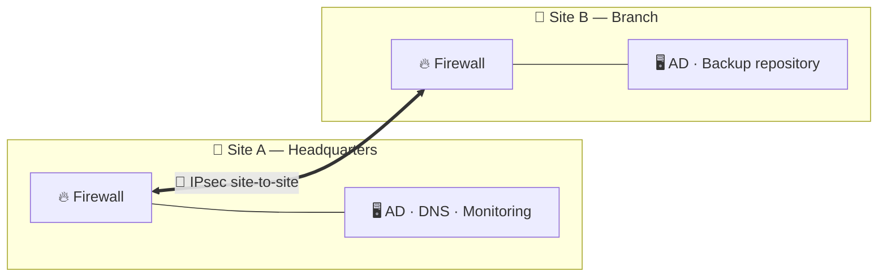

<!-- ═══════════════ HEADER ═══════════════ -->

 

---

## 👋 About me

I design, secure and keep **multi-site infrastructures** running.
My day-to-day sits at the crossroads of **networks**, **systems** and **security**: firewalls, VPNs, Active Directory, Microsoft 365, monitoring and backups.

> 💡 My approach: understand *why* it works before touching *how*. Evidence over assumptions, documentation over memory.

<table>
<tr>
<td width="50%" valign="top">

### 🎯 Focus areas
- 🔥 **Perimeter security** & firewalling
- 🌐 **Network segmentation** (VLAN, inter-VLAN policies)
- 🔐 **Site-to-site VPN** architectures (IPsec)
- ♻️ **Infrastructure reliability** (MCO)
- ☁️ **Microsoft 365 / Entra ID** environments

</td>
<td width="50%" valign="top">

### 🎓 Background
- 🏫 **MSc in Computer Science & Information Systems**
  EPSI Montpellier
- 💼 **Systems & Networks Engineer** @ E-MSN
- 🧭 Work-study track: field experience from day one

</td>
</tr>
</table>

---

## 🧰 Tech stack

### 🌐 Network & Security

### 🖥️ Systems & Cloud

### ⚙️ Automation & IaC

### 📈 Monitoring, Backup & Telecom

---

## 🗺️ What I build: a multi-site reference design

---

## 🚧 Currently exploring

<!-- Keep only what you are really working on. -->

| 🔬 Topic | 🎯 Goal |
| :-- | :-- |
| **FortiGate** | VLAN segmentation, policy design, `debug flow` troubleshooting |
| **IPsec & dynamic routing** | Site-to-site tunnels, OSPF over VPN |
| **Zabbix** | SNMP / agent monitoring with meaningful alerting |
| **Veeam Backup & Replication** | 3-2-1 strategy, off-site copy, *tested* restores |

> 🧪 Homelab: Proxmox + FortiGate + a fictional two-site company, built to break things, diagnose them and document the fix.

---

## 📊 GitHub stats

---

## 📫 Let's connect

---

## 🌟 Beyond tech

🎮 **Esport** — CS2 & Team Vitality &nbsp;|&nbsp; 🏋️ **Fitness** &nbsp;|&nbsp; 📘 **Continuous learning**

